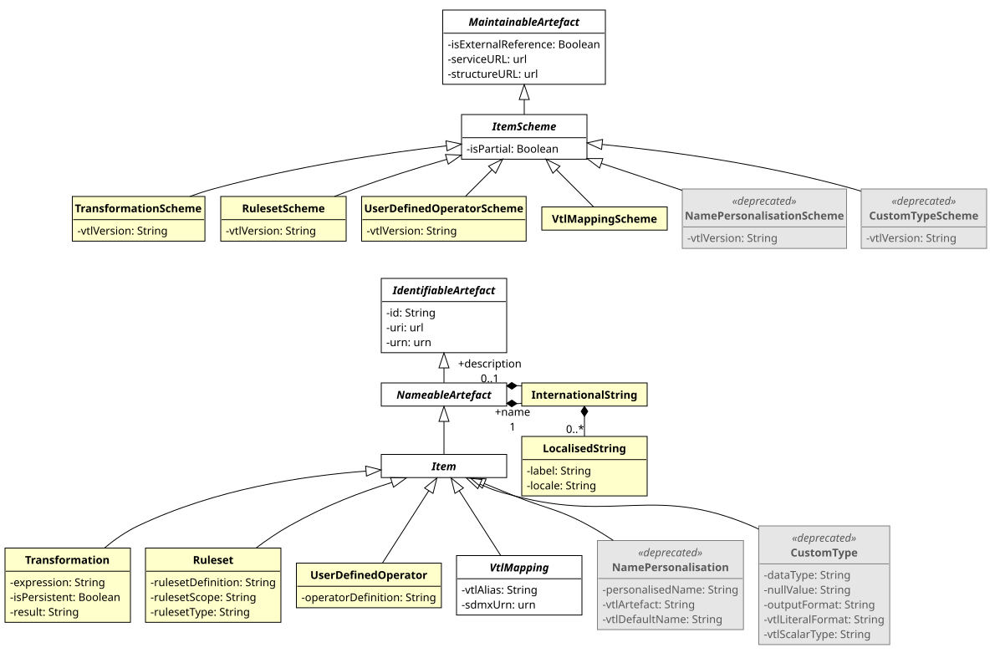
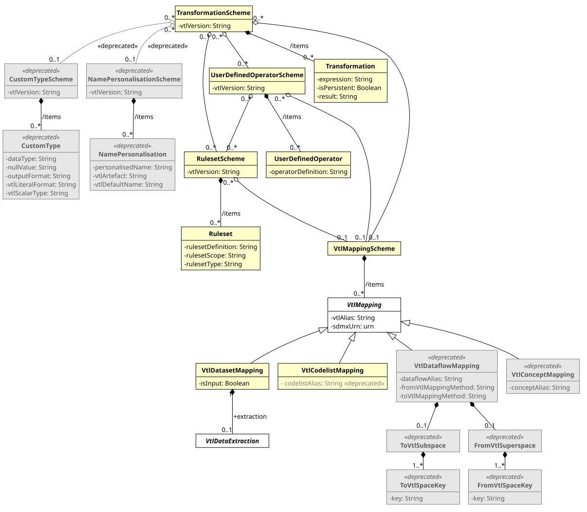
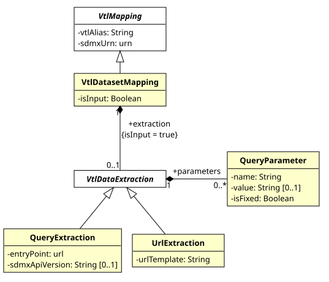

# Validation and Transformation Language

## Introduction

This SDMX model package supports the definition of Transformations,
which are algorithms to calculate new data starting from already
existing ones, written using the Validation and Transformation Language
(VTL)[^1].

[^1]: The Validation and Transformation Language is a standard language
    designed and published under the SDMX initiative. VTL is described
    in the VTL User and Reference Guides available on the [SDMX website](https://sdmx.org).

The purpose of this model package is to enable the:

- definition of validation and transformation algorithms by means of
    VTL, in order to specify how to calculate new SDMX data from
    existing ones;
- exchange of the definition of VTL algorithms, also together the
    definition of the data structures of the involved data (for example,
    exchange the data structures of a reporting framework together with
    the validation rules to be applied, exchange the input and output
    data structures of a calculation task together with the VTL
    transformations describing the calculation algorithms);
- execution of VTL algorithms, either interpreting the VTL
    transformations or translating them in whatever other computer
    language is deemed as appropriate;
- optional definition of where the data of the input VTL Data Sets can
    be retrieved from (e.g. a web service compliant with the SDMX
    REST API), so that a VTL program can be executed on the basis of its
    SDMX definition.

This model package does not explain the VTL language or any of the
content published in the VTL guides. Rather, this is an illustration of
the SDMX classes and attributes that allow defining VTL transformations
applied to SDMX artefacts.

The SDMX model represented below is consistent with the VTL 2.0
specification and its subsequent revisions (e.g. VTL 2.1 and 2.2). However, the
former uses the SDMX terminology and is a
model at technical level (from which the SDMX implementation artefacts
for defining VTL transformations are built), whereas the latter uses the
VTL terminology and is at conceptual level. The guidelines for mapping
these terminologies and using the VTL in the SDMX context can be found
in a dedicated chapter 
[Validation and Transformation Language of the Section SDMX Technical Notes](../../technical_notes/technical_notes/11_Validation_and_Transformation_Language__VTL_.md), 
often referenced below.

In SDMX 3.2, the interconnection between VTL and SDMX has been
simplified and aligned with the SDMX 3 model. The VTL Data Sets can be
mapped to Data Structure Definitions, Dataflows and Provision
Agreements, and the Basic mapping is the only method for converting the
data structures between SDMX and VTL. The retrieval of the data of the
input VTL Data Sets can also be specified. The constructs made redundant
by these changes have been deprecated. They are still described below
for the existing definitions that use them, but they should not be used
in new definitions. The conversion of the existing definitions is
described in the Section
[“Conversion of definitions based on deprecated constructs” in the SDMX Technical Notes](../../technical_notes/technical_notes/11_Validation_and_Transformation_Language__VTL_.md#conversion-of-definitions-based-on-deprecated-constructs).
In the diagrams, the deprecated classes are shown in grey and marked as
«deprecated». The same applies to the deprecated attributes of the
classes that are not deprecated (i.e. the `codelistAlias`). The
associations of the deprecated classes are also shown in grey, and are
marked as «deprecated» when they link a class that is not deprecated.

## Model - Inheritance view

### Class Diagram

/// figure-caption | 47
Class inheritance diagram in the Transformations and
Expressions Package
///

### Explanation of the Diagram

#### Narrative

The model artefacts `TransformationScheme`, `RulesetScheme`,
`UserDefinedOperatorScheme` and `VtlMappingScheme`, as well as the
deprecated `NamePersonalisationScheme` and `CustomTypeScheme`, inherit
from `ItemScheme`.

These schemes inherit from the `ItemScheme` and therefore have the
following attributes:

- `id`
- `agencyID`
- `urn`
- `+link`
- `version`
- `validFrom`
- `validTo`
- `isExternalReference`
- `registryURL`
- `structureURL`
- `repositoryURL`
- `isPartial`

The model artefacts `Transformation`, `Ruleset`, `UserDefinedOperator` and
`VtlMapping`, as well as the deprecated `NamePersonalisation` and
`CustomType`, inherit the attributes and associations of `Item` which
itself inherits from `NameableArtefact`. They have the following
attributes:

- `id`
- `urn`
- `+link`

The multi-lingual name and description are provided by the relationship
to `InternationalString` from `NameableArtefact`.

The `VtlMapping` also has the attributes `vtlAlias` and `sdmxUrn` (see
the [VTL Mapping Section](#vtl-mapping) below). The `VtlDataExtraction`,
with its subclasses `QueryExtraction` and `UrlExtraction`, and the
`QueryParameter` are not identifiable, as they are part of a
`VtlDatasetMapping` (see the
[VTL Data Extraction Section](#vtl-data-extraction) below).

## Model - Relationship View

### Class Diagram

/// figure-caption
Relationship diagram in the Transformations and Expressions
Package
///

### Explanation of the Diagram

#### Narrative - Overview

##### Transformation Scheme

A `TransformationScheme` is a set of `Transformation`s aimed at obtaining
some meaningful results for the user (e.g. the validation of one or more
Data Sets). This set of `Transformation`s is meant to be executed together
(in the same run) and may contain any number of `Transformation`s in order
to produce any number of results. Therefore, a `TransformationScheme` can
be considered as a VTL program.

The `TransformationScheme` must include the attribute `vtlVersion` expressed
as a string (e.g. “2.2”), as the version of the VTL determines which
syntax is used in defining the transformations of the scheme.

A `Transformation` consists of a statement which assigns the outcome of
the evaluation of a VTL expression to a result (an artefact of the VTL
Information Model, typically a VTL Data Set). In the SDMX context, a VTL
Data Set can be mapped to a `DataStructureDefinition`, a `Dataflow` or a
`ProvisionAgreement` (see the [VTL Mapping Section](#vtl-mapping) below).

For example, assume that D1, D2 and D3 are SDMX Dataflows (called Data
Sets in VTL) containing information on some goods, specifically: D3 the
current stocks, D1 the stocks of the previous date, D2 the flows in the
last period. A possible VTL `Transformation` aimed at checking the
consistency between flows and stocks is the following:

`Dr := If ( (D1 + D2) = D3, then "true", else "false")`

In this `Transformation`:

- `Dr` is the result (a new VTL Data Set)
- `:=` is an assignment operator
- `If((D1+D2)=D3, then "true", else "false")` is the expression
- `D1, D2, D3` are the operands
- `If, ( ), +, =` are VTL operators

The `Transformation` model artefact contains three attributes:

1. `result`

    The left-hand side of a VTL statement, which specifies the Artefact to
    which the outcome of the expression is assigned. An artefact cannot be
    result of more than one `Transformation`.

2. `isPersistent`

    An assignment operator, which specifies also the persistency of the
    left-hand side. The assignment operators are two, namely `:=` for
    non-persistent assignment (the result is non-persistent) and `<-`
    for persistent assignment (the result is persistent).

3. `expression`

    The right-hand side of a VTL statement, which is the expression to be
    evaluated. An expression consists in the invocation of VTL operators
    in a certain order. When an operator is invoked, for each input
    parameter, an actual argument is passed to the operator, which returns
    an actual argument for the output parameter. An expression is simply a
    text string written according the VTL grammar.

Because an Artefact can be the result of just one `Transformation` and a
Transformation belongs to just one `TransformationScheme`, it follows also
that a derived Artefact (e.g., a new VTL Data Set) is produced in just one
`TransformationScheme`.

The result of a `Transformation` can be input of other `Transformation`s.
The VTL assumes that non-persistent results are maintained only within
the same `TransformationScheme` in which they are produced. Therefore, a
non-persistent result of a `Transformation` can be the operand of other
Transformations of the same `TransformationScheme`, whereas a persistent
result can be operand of transformations of any `TransformationScheme`[^3].

[^3]: Provided that the VTL consistency rules are accomplished (see the “Generic Model for Transformations” in the VTL User Manual and its sub-section “Transformation Consistency”)

The `TransformationScheme` has an association to zero or more
`RulesetScheme`, zero or more `UserDefinedOperatorScheme`, zero or one
`VtlMappingScheme`, zero or one `NamePersonalisationScheme` and zero or
one `CustomTypeScheme` (the last two associations are deprecated, like
the related schemes).

Like the `TransformationScheme`, the `RulesetScheme` and the
`UserDefinedOperatorScheme` must include the attribute `vtlVersion`,
which the deprecated `NamePersonalisationScheme` and `CustomTypeScheme`
also have. Thus, a `TransformationScheme` using a specific
version of VTL can be linked to such schemes only if they are consistent
with the same VTL version.

The `VtlMappingScheme` associated to a `TransformationScheme` must
contain the mappings between the aliases used in the
`TransformationScheme` for referencing SDMX artefacts and the URNs of
these artefacts. As the VTL is strongly typed and has no declarations of
variables, these mappings provide the definitions of the VTL Data Sets
and Value Domains used in the `TransformationScheme`: therefore, a
`TransformationScheme` that references SDMX artefacts is complete only
together with its `VtlMappingScheme`. The association remains optional
(zero or one), which also allows for the deprecated references to SDMX
artefacts made directly through their URN in the VTL statements (see the
[VTL Mapping Section](#vtl-mapping) below).

##### Ruleset Scheme

Some VTL Operators can invoke rulesets, i.e., sets of previously defined
rules to be applied by the Operator. Once defined, a Ruleset is
persistent and can be invoked as many times as needed. The knowledge of
the rulesets’ definitions (if any) is essential for understanding the
actual behaviour of the `Transformation` that use them: this is achieved
through the `RulesetScheme` model artefact. The `RulesetScheme` is the
container for one or more Ruleset.

The Ruleset model artefact contains the following attributes:

1. `rulesetType` – the type of the ruleset according to VTL (VTL 2.0
    allows two types: “datapoint” and “hierarchical” ruleset; VTL 2.2
    adds the “viral” type for the viral propagation, see below);
2. `rulesetScope` – the VTL artefact on which the ruleset is defined; VTL
    2.0 allows rulesets defined on Value Domains, which correspond to
    SDMX `Codelists`, and rulesets defined on Variables, which correspond
    to the homonymous components of the VTL Data Sets on which the
    rulesets are applied (see below);
3. `rulesetDefinition` – the VTL statement that defines the ruleset
    according to the syntax of the VTL definition language.

From VTL 2.2, a Ruleset can also define a viral propagation, i.e. the
algorithm for combining the values of a viral Attribute. Its
`rulesetType` is “viral” and its `rulesetDefinition` is a
`define viral propagation` statement. Like the other rulesets, it is
defined on a Value Domain or on a Variable (`rulesetScope`).

The viral propagations also determine which VTL Attributes are viral.
An SDMX `DataAttribute` is mapped to a viral VTL Attribute when a
`RulesetScheme` linked to the `TransformationScheme` contains a viral
propagation for it. The viral propagation can be defined on its
Variable, named after its id, or on its Value Domain, i.e. the
`Codelist` of its representation. The other `DataAttributes` are mapped
to non-viral VTL Attributes.[^17]

[^17]: See the Section
    [“Mapping from SDMX to VTL data structures” in the SDMX Technical Notes](../../technical_notes/technical_notes/11_Validation_and_Transformation_Language__VTL_.md#mapping-from-sdmx-to-vtl-data-structures).

A viral propagation is not invoked by the operators. Once defined, it
is applied by all the operators that propagate the viral Attributes.
Therefore, a `TransformationScheme` that uses viral propagations is
complete only together with the `RulesetScheme`s that contain them.
These `RulesetScheme`s cannot contain more than one viral propagation
for the same Value Domain or Variable.

The `RulesetScheme` can have an association with zero or one
`VtlMappingScheme`, which contains the mappings between the aliases used
in the `rulesetDefinition` for referencing SDMX artefacts and the URNs of
these artefacts.

The rulesets defined on Value Domains reference `Codelists`, which are
mapped to the VTL Value Domains through the `VtlCodelistMapping`. The
rulesets defined on Variables reference the VTL Variables, which
correspond to the components having the same names in the VTL Data Sets
on which the rulesets are applied. Under the Basic mapping, these names
are the ids of the SDMX `Components`; therefore, these references do not
need any mapping (the `VtlConceptMapping`, formerly used to map Variables
to SDMX `Concepts`, is deprecated). In conclusion, in the VTL rulesets
there can exist mappings for `Codelists`.

##### User Defined Operator Scheme

The `UserDefinedOperatorScheme` is a container for zero or more
`UserDefinedOperator`. The `UserDefinedOperator` is defined using VTL
standard operators. This is essential for understanding the actual
behaviour of the `Transformation`s that invoke them.

The attribute `operatorDefinition` contains the VTL statement that defines
the operator according to the syntax of the VTL definition language.

Although the VTL user defined operators are conceived to be defined on
generic operands, so that the specific artefacts to be manipulated are
passed as parameters at the invocation, it is also possible that they
reference specific SDMX artefacts like `Dataflows` and `Codelists`.
Therefore, the `UserDefinedOperatorScheme` can link to zero or one
`VtlMappingScheme`, which must contain the mappings between the VTL
aliases and the URNs of the corresponding SDMX artefacts (see the
[VTL Mapping Section](#vtl-mapping) below).

The definition of a `UserDefinedOperator` can also make use of VTL
rulesets; therefore, the `UserDefinedOperatorScheme` can link to zero, one
or more `RulesetScheme`, **which** must contain the definition of these
Rulesets (see also the [Ruleset Scheme Section](#ruleset-scheme) above).

##### VTL Mapping

The mappings between SDMX and VTL establish the correspondence between
the names used in VTL for referencing the SDMX artefacts and the
artefacts themselves, and determine how the data structures are
converted from SDMX to VTL and vice-versa. These features are achieved
through the `VtlMappingScheme`, which is a container for zero or more
`VtlMapping`.

The VTL assumes that the operands are directly referenced through their
actual names (unique identifiers). In the VTL transformations, rulesets
and user defined operators, the SDMX artefacts are referenced through
VTL aliases, i.e. names compliant with the VTL naming rules. Each
`VtlMapping` defines the correspondence between a VTL alias
(`vtlAlias`) and the URN of the referenced SDMX artefact (`sdmxUrn`),
which identifies the artefact and its class without ambiguity. The alias
must be unique within its `VtlMappingScheme`, while the same SDMX
artefact can be referenced through different aliases.[^5]

[^5]: The references to SDMX artefacts written directly in the VTL
    statements through their URN or an abbreviation of their URN,
    described in the Section
    [“References to SDMX artefacts from VTL statements” in the SDMX Technical Notes](../../technical_notes/technical_notes/11_Validation_and_Transformation_Language__VTL_.md#references-to-sdmx-artefacts-from-vtl-statements),
    have been deprecated.

The `vtlAlias` and the `sdmxUrn` are mandatory, except that the
deprecated `VtlDataflowMapping` having the conventional alias
“generic_dataflow” (see below) has no `sdmxUrn`, as it does not
reference any `Dataflow`.
The deprecated `dataflowAlias`, `codelistAlias` and `conceptAlias` of
the subclasses are superseded by the `vtlAlias`: they are optional and,
if present, have the same value as the `vtlAlias`.

The SDMX artefacts that can be mapped correspond to the following
subclasses of `VtlMapping`:

- `VtlDatasetMapping`, which maps a VTL Data Set to an SDMX
    `DataStructureDefinition`, `Dataflow` or `ProvisionAgreement`;
- `VtlCodelistMapping`, which maps a VTL Value Domain to an SDMX
    `Codelist`.

The `isInput` attribute of the `VtlDatasetMapping` specifies whether the
VTL Data Set is an input of the VTL program (`true`), whose
definition and data are obtained from SDMX, or an output of the VTL
program (`false`), whose data are converted into SDMX. The following
rules apply:

1. The `isInput` attribute is mandatory. A VTL alias identifies a VTL
    Data Set that is either read or written by the VTL program;
    therefore, an SDMX artefact used both as input and as output is mapped by two
    `VtlDatasetMapping`s having distinct aliases.
2. The outputs must be persistent, i.e. the `vtlAlias` of a
    `VtlDatasetMapping` having `isInput` equal to `false` must be the
    `result` of a `Transformation` whose `isPersistent` is `true`.
3. The data structures of the VTL Data Set and of the referenced SDMX
    artefact (i.e. the `DataStructureDefinition` itself or the one used
    by the `Dataflow`, referenced directly or through the
    `ProvisionAgreement`) correspond to one another according to the
    Basic mapping method[^15]. This method maps the SDMX `Dimensions` and
    `TimeDimension` to VTL Identifiers, the SDMX `Measures` to VTL
    Measures and the SDMX `DataAttributes` to VTL Attributes (viral or
    non-viral, see the [Ruleset Scheme Section](#ruleset-scheme) above),
    and vice-versa. For an input, the data structure of the VTL Data Set is
    obtained from the SDMX one; for an output, the data structure of the
    result of the `Transformation` must correspond to that of the
    referenced SDMX artefact.
4. The mapping is many-to-many, i.e. a `TransformationScheme` can use any
    number of VTL Data Sets, and the same SDMX artefact can be
    referenced by different `VtlDatasetMapping`s, within the same
    `VtlMappingScheme` or in different ones. For example, two VTL Data
    Sets can be mapped to the same `DataStructureDefinition` and be fed
    with different parts of its data (see the
    [VTL Data Extraction Section](#vtl-data-extraction) below).

[^15]: For a thorough description of the Basic mapping, see the Section
    [“Mapping between SDMX and VTL artefacts” in the SDMX Technical Notes](../../technical_notes/technical_notes/11_Validation_and_Transformation_Language__VTL_.md#mapping-between-sdmx-and-vtl-artefacts).

The `VtlCodelistMapping` maps an SDMX `Codelist` to a VTL Value Domain:
the `vtlAlias` is the name of the Value Domain and the `sdmxUrn` is the
URN of the `Codelist`, whose `Codes` are the values of the Value Domain.
As the VTL programs do not produce Value Domains, the
`VtlCodelistMapping` is used only for inputs and does not have the
`isInput` attribute.

As the VTL is strongly typed and does not include declarations of
variables, the `VtlMapping`s act as the definitions of the VTL Data Sets
and Value Domains referenced by a VTL program, whose data structures and
values are derived from the referenced SDMX artefacts. Therefore, the
`VtlMappingScheme` is part of the definition of the
`TransformationScheme`s, `RulesetScheme`s and
`UserDefinedOperatorScheme`s that reference SDMX artefacts.

##### VTL Data Extraction

The `VtlMapping`s define the VTL Data Sets and Value Domains used by a
VTL program. In order to execute the program, the data of the input VTL
Data Sets also need to be retrieved. The `VtlDataExtraction` specifies
where and how the data of an input VTL Data Set can be obtained,
typically through a query to a web service compliant with the SDMX REST
API, which returns the SDMX data to be converted into the VTL Data Set.

/// figure-caption
Data extraction diagram in the Transformations and Expressions
Package
///

The `VtlDataExtraction` is optional. When it is not defined, the data to
be processed are provided to the VTL engine at run time (the mechanism
for doing so is not part of this specification). When it is defined,
the VTL engine can retrieve the data directly, so that the
`TransformationScheme` can be executed on the basis of its SDMX
definition: the data structures are obtained from the SDMX artefacts
referenced by the `VtlMapping`s and the data from the
`VtlDataExtraction`s.

A `VtlDatasetMapping` having `isInput` equal to `true` can contain zero
or one `VtlDataExtraction`, while a `VtlDatasetMapping` having `isInput`
equal to `false` cannot contain any, as the outputs are produced by the
`TransformationScheme` (the storage of the persistent results is up to
the VTL engine). The Value Domains do not need any `VtlDataExtraction`,
as their values are obtained from the referenced `Codelists`.

The `VtlDataExtraction` is an abstract class, which contains zero or
more `QueryParameter`s and has two subclasses:

- `QueryExtraction`, meant for web services compliant with the SDMX
    REST API. It specifies the entry point of the web service
    (`entryPoint`) and, optionally, the version of the SDMX REST API
    implemented by the entry point (`sdmxApiVersion`), which determines
    the syntax of the query. The VTL engine builds the query for the
    data of the SDMX artefact referenced by the `sdmxUrn` of the
    `VtlDatasetMapping`, according to the syntax of the SDMX REST API
    version, by using the `QueryParameter`s (e.g. the `key` and the
    query parameters for selecting the periods).
- `UrlExtraction`, meant for web services that are not fully
    compliant with the SDMX REST API. It specifies the complete URL of
    the query through a template (`urlTemplate`), whose tokens enclosed
    in curly braces (e.g. `{startPeriod}`) are replaced by the values of
    the homonymous `QueryParameter`s.

A `QueryParameter` is a name-value pair (`name` and `value`), which can
be fixed or not (`isFixed`):

- a fixed parameter (`isFixed` equal to `true`) must have a `value`,
    which is always used as it is;
- a non-fixed parameter (`isFixed` equal to `false`) can have a
    `value`, which is a default that can be overridden at run time; if
    it has no `value`, its value must be provided at run time.

The `name` of a `QueryParameter` is unique within its
`VtlDataExtraction`.

The non-fixed parameters allow the same `TransformationScheme` to be
executed repeatedly, for example for different periods, without changing
its definition. The values provided at run time are assigned to the input
VTL Data Sets through their aliases. As the same SDMX artefact can be
mapped to several VTL Data Sets, its URN does not identify a VTL Data Set
univocally, while each `VtlDataExtraction` belongs to just one
`VtlDatasetMapping`.

The restriction of the data to the part of interest (e.g. to some values
of some `Dimensions`, or to some periods) is expressed in the query
through the `QueryParameter`s (e.g. a fixed `key` containing wildcards).
The `VtlDataExtraction` does not reference other SDMX artefacts (e.g.
`Constraints`).

The `VtlDataExtraction` and the `QueryParameter` are not identifiable:
they are part of their `VtlDatasetMapping`.[^16]

[^16]: For guidance on the use of the VTL data extraction and for some
    examples, see the Section
    [“Retrieving the data of the input VTL Data Sets” in the SDMX Technical Notes](../../technical_notes/technical_notes/11_Validation_and_Transformation_Language__VTL_.md#retrieving-the-data-of-the-input-vtl-data-sets).

##### Name Personalisation Scheme

!!! note
    The `NamePersonalisationScheme` and the `NamePersonalisation` have
    been deprecated in SDMX 3.2; thus, the names assigned by default by
    the VTL operators (e.g. `bool_var`, `errorcode`) can be changed in the
    VTL program, for example through the VTL `rename` clause.

In some operations, the VTL assigns by default some standard names to
some measures and/or attributes of the data structure of the result[^4].
The VTL allows also to personalise the names to be assigned. The
knowledge of the personalised names (if any) is essential for
understanding the actual behaviour of the `Transformation`: this is
achieved through the `NamePersonalisationScheme`. A `NamePersonalisation`
specifies a personalised name that will be assigned in place of a VTL
default name. The `NamePersonalisationScheme` is a container for zero or
more `NamePersonalisation`.

[^4]: For example, the `check` operator produces some new components in the
    result called by default `bool_var`, `errorcode`, `errorlevel`, `imbalance`.
    These names can be personalised if needed.

##### `VtlDataflowMapping`, `VtlConceptMapping`

!!! note
    The `VtlDataflowMapping` and the `VtlConceptMapping` have been
    deprecated in SDMX 3.2; thus, a VTL Data Set is mapped to a `Dataflow`
    through a `VtlDatasetMapping` whose `sdmxUrn` is the URN of the
    `Dataflow`. The VTL Variables correspond to the homonymous components
    of the VTL Data Sets and do not need any mapping.

The deprecated `VtlDataflowMapping` maps a VTL Data Set to an SDMX
`Dataflow` and also allows specifying the method to convert the data
structure of the `Dataflow`. This kind of conversion can happen in two
directions, from SDMX to VTL when an SDMX Dataflow is accessed by a VTL
Transformation (`toVtlMappingMethod`), or from VTL to SDMX when an SDMX
derived Dataflow is calculated through VTL (`fromVtlMappingMethod`).[^6]

[^6]: For a more thorough description of these conversions, see the 
    Section [“Mapping between SDMX and VTL artefacts” in the SDMX Technical Notes](../../technical_notes/technical_notes/11_Validation_and_Transformation_Language__VTL_.md#mapping-between-sdmx-and-vtl-artefacts).

!!! note
    The alternative mapping methods described below have been deprecated
    in SDMX 3.2; thus, the Basic mapping is the only mapping method
    between SDMX and VTL data structures. Any restructuring of the data
    (e.g. pivoting, or changing the role of some components) is performed
    in the VTL program through the VTL operators (e.g. the
    `pivot`, `unpivot` and `calc` clauses).

The default mapping method from SDMX to VTL is called “Basic”. Three
alternative mapping methods are possible, called “Pivot”, “Basic-A2M”,
“Pivot-A2M” (“A2M” stands for “Attributes to Measures”, i.e. the SDMX
`DataAttributes` become VTL measures).

The default mapping method from VTL to SDMX is also called “Basic”, and
the two alternative mapping methods are called “Unpivot” and “M2A”
(“M2A” stands for “Measures to Attributes”, i.e. some VTL measures
become SDMX `DataAttributes` according to what is declared in the DSD).

In both the mapping directions, no specification is needed if the
default mapping method (Basic) is used. When an alternative mapping
method is applied for some Dataflow, this must be specified in
`toVtlMappingMethod` or `fromVtlMappingMethod`. The mapping methods to be
applied by default, instead of the Basic ones, can be declared through a
`VtlDataflowMapping` having the conventional alias “generic_dataflow”,
which does not reference any `Dataflow`.

The deprecated `VtlConceptMapping` maps a VTL alias to an SDMX `Concept`,
referenced by its `sdmxUrn`.

##### `ToVtlSubspace`, `ToVtlSpaceKey`, `FromVtlSuperspace`, `FromVtlSpaceKey`

!!! note
    The `ToVtlSubspace`, `ToVtlSpaceKey`, `FromVtlSuperspace` and
    `FromVtlSpaceKey` have been deprecated in SDMX 3.2; thus, the same
    SDMX artefact can be mapped to distinct input VTL Data Sets, each one
    fed with the desired part of the SDMX data through the parameters of
    its `VtlDataExtraction` (see above). Parts of VTL Data Sets can be
    selected and combined in the VTL program through the VTL operators
    (e.g. `sub`, `filter`, `calc` and `union`).

Although in general one SDMX Dataflow is mapped to one VTL dataset and
vice-versa, it is also allowed to map distinct parts of a single SDMX
Dataflow to distinct VTL data sets according to the rules and
conventions described in the Section 6 of the SDMX Standards.[^7]

[^7]: See the Section [“Mapping dataflow subsets to distinct VTL data sets” in the SDMX Technical Notes](../../technical_notes/technical_notes/11_Validation_and_Transformation_Language__VTL_.md#mapping-dataflow-subsets-to-distinct-vtl-data-sets). 

In the direction from SDMX to VTL, this is achieved by fixing the values
of some predefined Dimensions of the SDMX Data Structure: all the
observations having such combination of values are mapped to one
corresponding VTL dataset (the Dimensions having fixed values are not
maintained in the Data Structure of the resulting VTL dataset). The
`ToVtlSubspace` and `ToVtlSpaceKey` classes allow to define these
Dimensions. When one SDMX Dataflow is mapped to just one VTL dataset
these classes are not used.

Analogously, in the direction from VTL to SDMX, it is possible to map
more calculated VTL datasets to distinct parts of a single SDMX
Dataflow, as long as these VTL datasets have the same Data Structure.
This can be done by providing, for each VTL dataset, distinct values for
some additional SDMX Dimensions that are not part of the VTL data
structure. The `FromVtlSuperspace` and `FromVtlSpaceKey` classes allow to
define these dimensions. When one VTL dataset is mapped to just one SDMX
Dataflow these classes are not used.

##### Custom Type Scheme

!!! note
    The `CustomTypeScheme` and the `CustomType` have been deprecated in
    SDMX 3.2; thus, the default conversions between VTL and SDMX data
    types apply, unless overridden by the representation specified in the
    `DataStructureDefinition` of the resulting SDMX artefact. The VTL NULLs
    become missing values in SDMX, the VTL literals are written in the
    default format, and explicit type conversions are expressed in the VTL
    program through the VTL `cast` operator.

As already said, a `Transformation` consists of a statement which assigns
the outcome of the evaluation of a VTL expression to a result, i.e. an
artefact of the VTL Information Model, which in the SDMX context can be
mapped to a `DataStructureDefinition`, a `Dataflow` or a
`ProvisionAgreement`[^8]. Therefore, the VTL data type of the outcome of
the VTL expression has to be converted into the SDMX data type of the
resulting SDMX artefact. A default conversion table
from VTL to SDMX data types is assumed[^9]. The `CustomTypeScheme` allows
to specify custom conversions that override the default conversion
table. The `CustomTypeScheme` is a container for zero or more `CustomType`.
A `CustomType` specifies the custom conversion from a VTL scalar type that
will override the default conversion. The overriding SDMX data type is
specified by means of the `dataType` and `outputFormat` attributes (the SDMX
data type assumes the role of external representation in respect to
VTL[^10]).

[^8]: Or, through the deprecated `FromVtlSuperspace`, a part of a
    `Dataflow`, as described in the previous paragraph.

[^9]: The default conversion table from VTL to SDMX is described in the
    Section [“Mapping VTL basic scalar types to  SDMX data types” in the SDMX Technical Notes](../../technical_notes/technical_notes/11_Validation_and_Transformation_Language__VTL_.md#mapping-vtl-basic-scalar-types-to-sdmx-data-types).

[^10]: About VTL internal and external representations, see also the 
    VTL User Manual, section “Basic scalar types”, p.53.

Moreover, the `CustomType` allows to customize the default format of VTL
literals and the (possible) SDMX value to be produced when a VTL measure
or attribute is NULL.

VTL expression can contain literals, i.e. specific values of a certain
VTL data type written according to a certain format. For example,
consider the following `Transformation` that extracts from the dataflow D1
the observations for which the "reference_date" belongs to the years
2018 and 2019:

`Dr := D1 [ filter between (reference_date, 2018-01-01, 2019-12-31)]`

In this expression, the two values `2018-01-01` and `2019-12-31` are
literals of the VTL “date” scalar type expressed in the format
`YYYY-MM-DD`.

The VTL literals are assumed to be written in the same SDMX format
specified in the default conversion table mentioned above, for the
conversion from VTL to SDMX data types. If a different format is used
for a certain VTL scalar type, it must be specified in the
`vtlLiteralFormat` attribute of the `CustomType`.

Regarding the management of NULLs, in the conversions between SDMX and
VTL, by default a missing value in SDMX in converted in VTL NULL and
vice-versa, for any VTL scalar type. If a different value is needed,
after the conversion from SDMX to VTL, proper VTL operators can be used
for obtaining it. In the conversion from VTL to SDMX the desired value
can be declared in the `nullValue` attribute (separately for each VTL
basic scalar type).

#### Definitions

| Class | Feature | Description |
| --- | --- | --- |
| Transformation Scheme | Inherits from `ItemScheme` | Contains the definitions of transformations meant to produce some derived data and be executed together |
|  | `vtlVersion` | The version of the VTL language used for defining transformations (mandatory). |
| Transformation | Inherits from `Item` | A VTL statement which assigns the outcome of an expression to a result. |
|  | result | The left-hand side of the VTL statement, which identifies the result artefact. |
|  | `isPersistent` | A boolean that indicates whether the result is permanently stored or not, depending on the VTL assignment operator. |
|  | expression | The right-hand side of the VTL statement that is the expression to be evaluated, which includes the references to the operands of the Transformation. |
| `RulesetScheme` | Inherits from `ItemScheme` | Container of rulesets. |
|  | `vtlVersion` | The version of the VTL language used for defining the rulesets (mandatory). |
| Ruleset | Inherits from `Item` | A persistent set of rules which can be invoked by means of appropriate VTL operators, or a viral propagation, which determines the viral Attributes and is applied by the VTL operators that propagate them. |
|  | `rulesetDefinition` | A VTL statement for the definition of a ruleset (according to the syntax of the VTL definition language) |
|  | `rulesetType` | The VTL type of the ruleset (e.g., in VTL 2.0, datapoint or hierarchical; VTL 2.2 adds viral, for the viral propagation) |
|  | `rulesetScope` | The model artefact on which the ruleset is defined (e.g., in VTL 2.0, valuedomain or variable) |
| `UserDefinedOperatorScheme` | Inherits from `ItemScheme` | Container of user defined operators |
|  | `vtlVersion` | The version of the VTL language used for defining the user defined operators (mandatory). |
| `UserDefinedOperator` | Inherits from `Item` | Custom VTL operator (not existing in the standard library) that extends the VTL standard library for specific purposes. |
|  | `operatorDefinition` | A VTL statement for the definition of a new operator: it specifies the operator name, its parameters and their data types, the VTL expression that defines its behaviour. |
| `VtlMappingScheme` | Inherits from `ItemScheme` | Container of VTL mappings. |
| `VtlMapping` | Abstract class Inherits from `Item` Sub classes are: `VtlDatasetMapping`, `VtlCodelistMapping`, `VtlDataflowMapping` (deprecated), `VtlConceptMapping` (deprecated) | Single mapping between the alias used in VTL transformations, rulesets or user defined operators for referencing an SDMX artefact and the URN of this artefact. |
|  | `vtlAlias` | The alias used in VTL for referencing the SDMX artefact, compliant with the VTL naming rules (mandatory). The alias must be unique within the `VtlMappingScheme`. |
|  | `sdmxUrn` | The URN of the SDMX artefact referenced through the alias (mandatory, except for the deprecated `VtlDataflowMapping` having the conventional alias “generic_dataflow”). |
| `VtlDatasetMapping` | Inherits from `VtlMapping` | Single mapping between a VTL Data Set and the SDMX `DataStructureDefinition`, `Dataflow` or `ProvisionAgreement` referenced by the `sdmxUrn`. |
|  | `isInput` | A mandatory boolean that indicates whether the VTL Data Set is an input of the VTL program (`true`), whose definition and data are obtained from SDMX, or an output (`false`), whose data are converted into SDMX. An output must be the result of a persistent `Transformation`. |
|  | `+extraction` | Association to the `VtlDataExtraction` that specifies how to retrieve the data of an input VTL Data Set. |
| `VtlCodelistMapping` | Inherits from `VtlMapping` | Single mapping between a VTL Value Domain and the SDMX `Codelist` referenced by the `sdmxUrn`, whose `Codes` are the values of the Value Domain. |
|  | `codelistAlias` | Deprecated. Replaced by the `vtlAlias`; if present, it has the same value. Name used in VTL to reference an SDMX codelist. The name/alias must be univocal: different SDMX artefacts cannot have the same VTL alias. |
| `VtlDataExtraction` | Abstract class Sub classes are: `QueryExtraction`, `UrlExtraction` | Specifies how to retrieve the data of an input VTL Data Set. |
|  | `+parameters` | Association to the `QueryParameter`s used for retrieving the data. |
| `QueryExtraction` | Inherits from `VtlDataExtraction` | Retrieval of the data through a query to a web service compliant with the SDMX REST API, built from the `entryPoint`, the `sdmxUrn` of the `VtlDatasetMapping` and the `QueryParameter`s. |
|  | `entryPoint` | The URL of the entry point of the SDMX REST web service. |
|  | `sdmxApiVersion` | The version of the SDMX REST API implemented by the entry point, written as major.minor (e.g. 2.1). If not specified, the default version of the web service is assumed. |
| `UrlExtraction` | Inherits from `VtlDataExtraction` | Retrieval of the data through a URL built from a template. |
|  | `urlTemplate` | The complete URL of the query, whose tokens enclosed in curly braces (e.g. `{startPeriod}`) are replaced by the values of the homonymous `QueryParameter`s. |
| `QueryParameter` |  | A name-value pair used for retrieving the data of an input VTL Data Set. |
|  | `name` | The name of the parameter (e.g. `key`, `startPeriod`), unique within the `VtlDataExtraction`. |
|  | `value` | The value of the parameter: mandatory if the parameter is fixed, otherwise a default value, which can be overridden at run time. |
|  | `isFixed` | A boolean that indicates whether the `value` is fixed (`true`) or can be overridden at run time (`false`). A non-fixed parameter without `value` must be given a value at run time. |
| `NamePersonalisationScheme` | Inherits from `ItemScheme` | Deprecated. Container of name personalisations. |
|  | `vtlVersion` | The VTL version which the VTL default names to be personalised belong to. |
| `NamePersonalisation` | Inherits from `Item` | Deprecated. Definition of personalised name to be used in place of a VTL default name. |
|  | `vtlArtefact` | VTL model artefact to which the VTL default name to be personalised refers, e.g. variable, value domain. |
|  | `vtlDefaultName` | The VTL default name to be personalised. |
|  | `personalisedName` | The personalised name to be used in place of the VTL default name. |
| `VtlDataflowMapping` | Inherits from `VtlMapping` | Deprecated. Replaced by the `VtlDatasetMapping`. Single mapping between the reference to an SDMX dataflow and the corresponding SDMX structure identifier |
|  | `dataflowAlias` | Deprecated. Replaced by the `vtlAlias`; if present, it has the same value. Alias used in VTL to reference an SDMX dataflow (it can be the URN, the abbreviated URN or a user defined alias). The alias must be univocal: different SDMX artefacts cannot have the same VTL alias. |
|  | `toVtlMappingMethod` | Deprecated. Custom specification of the mapping method from SDMX to VTL data structures for the dataflow (overriding the default “basic” method). |
|  | `fromVtlMappingMethod` | Deprecated. Custom specification of the mapping method from VTL to SDMX data structures for the dataflow (overriding the default “basic” method). |
| `VtlConceptMapping` | Inherits from `VtlMapping` | Deprecated. Single mapping between the VTL reference to an SDMX concept and the SDMX structure identifier of the concept. |
|  | `conceptAlias` | Deprecated. Replaced by the `vtlAlias`; if present, it has the same value. Name used in VTL to reference an SDMX concept. The name/alias must be univocal: different SDMX artefacts cannot have the same VTL alias. |
| `ToVtlSubspace` |  | Deprecated. Subspace of the dimensions of the SDMX dataflow used to identify the parts of the dataflow to be mapped to distinct VTL datasets |
| `ToVtlSpaceKey` |  | Deprecated. A dimension of the SDMX dataflow that contributes to identify the parts of the dataflow to be mapped to distinct VTL datasets. |
|  | Key | The identity of the dimension in the data structure definition of the dataflow that contributes to identify the parts of the dataflow to be mapped to distinct VTL datasets |
| `FromVtlSuperspace` |  | Deprecated. Superspace is composed of the dimensions to be added to the data structure of the VTL result dataset in order to obtain the data structure of the derived SDMX dataflow (in case the latter is a superset of distinct VTL datasets calculated independently). |
| `FromVtlSpaceKey` |  | Deprecated. An SDMX dimension to be added to the data structure of the VTL result dataset in order to obtain the data structure of the derived SDMX dataflow |
|  | Key | The identity of the dimension to be added to the data structure of the VTL result dataset in order to obtain the data structure of the derived SDMX dataflow. |
| `CustomTypeScheme` | Inherits from `ItemScheme` | Deprecated. Container of custom specifications for VTL basic scalar types. |
|  | `vtlVersion` | The VTL version, which the VTL scalar types belong to. |
| `CustomType` | Inherits from `Item` | Deprecated. Custom specification for a VTL basic scalar type. |
|  | `vtlScalarType` | VTL scalar type for which the custom specifications are given. |
|  | `outputFormat` | Custom specification of the VTL formatting mask needed to obtain to the desired representation, i.e. the desired SDMX format (e.g. YYYY-MM-DD, see also the VTL formatting mask in the VTL Reference Manual and the SDMX Technical Notes). If not specified, the “Default output format” of the default conversion table from VTL to SDMX is used. [^11] |
|  | `datatype` | Custom specification of the external (SDMX) data type in which the VTL data type must be converted (e.g. the `GregorianDay`). If not specified, the “Default SDMX data type” of the default conversion table from VTL to SDMX is used. [^12] |
|  | `nullValue` | Custom specification of the SDMX value to be produced for the VTL NULL values, with reference to the `vtlScalarType` specified above. If no value is specified, no value is produced. |
|  | `vtlLiteralFormat` | Custom specification of the format of the VTL literals belonging to the `vtlScalarType` used in the VTL program (e.g. YYYY-MM-DD)[^13]. If not specified, the “Default output format” of the default conversion table from VTL to SDMX is assumed.[^14] |

[^11]:
    See [“Mapping VTL basic scalar types to SDMX data types”
    in the SDMX Technical Notes](../../technical_notes/technical_notes/11_Validation_and_Transformation_Language__VTL_.md#mapping-vtl-basic-scalar-types-to-sdmx-data-types).
[^12]:
    See [“Mapping VTL basic scalar types to SDMX data types”
    in the SDMX Technical Notes](../../technical_notes/technical_notes/11_Validation_and_Transformation_Language__VTL_.md#mapping-vtl-basic-scalar-types-to-sdmx-data-types).
[^13]:
    See also the VTL formatting mask in the VTL Reference
    Manual and the [SDMX Technical Notes](../../technical_notes/technical_notes/11_Validation_and_Transformation_Language__VTL_.md#mapping-sdmx-data-types-to-vtl-basic-scalar-types).
[^14]:
    See [“Mapping VTL basic scalar types to SDMX data types”
    in the SDMX Technical Notes](../../technical_notes/technical_notes/11_Validation_and_Transformation_Language__VTL_.md#mapping-vtl-basic-scalar-types-to-sdmx-data-types).
